  

  <b>Computer science @ Texas A&amp;M</b> 
  Software engineering &nbsp;·&nbsp; AI &nbsp;·&nbsp; Game development &nbsp;·&nbsp; Creative design

 

I have ideas that I sit with for days, sometimes weeks, before I finally start building. **Being able to turn something I've imagined into something real is what makes computer science so exciting to me.** I enjoy the design just as much as the programming, and I like having the freedom to follow an idea wherever it takes me.

I know there's a lot of worry about AI taking the human element out of creative work. I see it differently. The ideas we choose to pursue still come from our own experiences, tastes, and imperfections. Having better tools to explore them feels like an opportunity to me. As a student learning while all of this is changing, I've never felt more confident that I can learn what I need to bring an idea to life.

 

---

  <em>“If you can imagine something great, you owe it to yourself to try and bring it to life.”</em>

